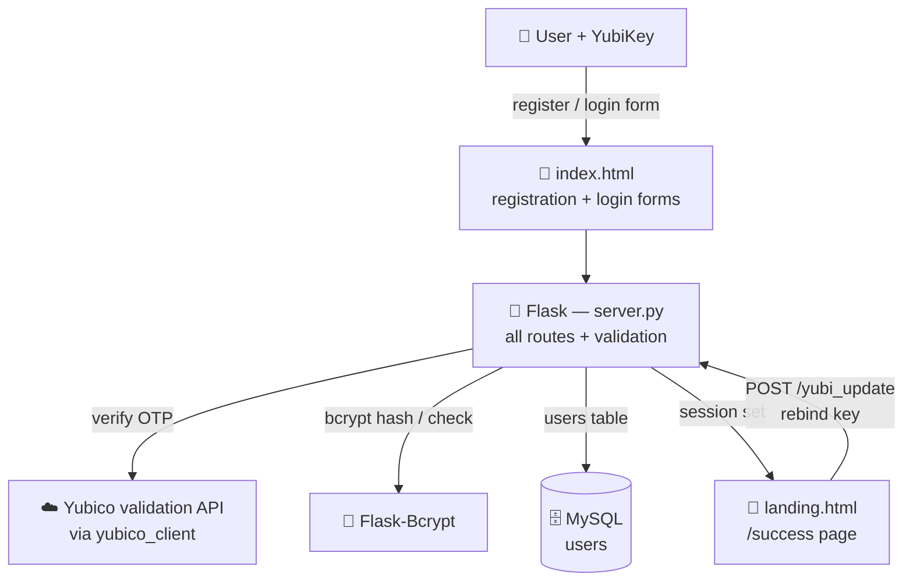

# 🔐 Yubi Login & Registration — Solo Version

> Chad's solo re-implementation of the YubiKey login/registration project: a Flask + MySQL app where signing in takes a bcrypt-checked password **and** a live [YubiKey](https://www.yubico.com/) OTP, verified against Yubico's cloud API with the key's device ID bound to the account.

**Status: archival coursework.** Built in January 2020 during the Coding Dojo Python stack, independently re-creating the design of the earlier [yubi_login_and_reg](https://github.com/tupacalypse187/yubi_login_and_reg) (December 2019) as a solo exercise. An RTF project document is included in the repo.

---

## 📑 Table of Contents

- [🏗️ Architecture](#️-architecture)
- [🔑 YubiKey Authentication Flow](#-yubikey-authentication-flow)
- [🗄️ Database](#️-database)
- [🚀 Running Locally](#-running-locally)
- [🔒 Security Notes](#-security-notes)

---

## 🏗️ Architecture

The same classic Dojo Flask shape as the original: one `server.py` with all routes, MySQL via the course's `mysqlconnection.py` helper, and two Jinja templates. OTP verification is delegated to Yubico's hosted validation service through the `yubico_client` library.



**Components:**

- 🐍 **`server.py`** — registration, login, landing page, YubiKey rebinding, and logout routes, with all form validation
- 🗄️ **`mysqlconnection.py`** — the Coding Dojo MySQL helper (PyMySQL)
- 🧾 **`templates/`** — `index.html` (register/login) and `landing.html` (authenticated page)
- 📐 **`yubi_login_and_reg.mwb`** — the MySQL Workbench schema model, shared with the original project

---

## 🔑 YubiKey Authentication Flow

1. 📝 **Register** — name, email, password, and a YubiKey touch. The OTP is verified with Yubico's API, its device ID (`otp.OTP(...).device_id`) is stored on the user row, and the password is bcrypt-hashed.
2. 🔓 **Login** — the OTP must verify live, the email + device ID must match one user row, and bcrypt must accept the password; only then is the session set.
3. 🔁 **Rebind** — `/yubi_update` from the landing page swaps the bound device ID after a fresh OTP check.

---

## 🗄️ Database

A single `users` table (first/last name, email, bcrypt password hash, bound YubiKey device ID, timestamps), modelled in [`yubi_login_and_reg.mwb`](yubi_login_and_reg.mwb).

---

## 🚀 Running Locally

Prerequisites: Python 3, MySQL with the schema above, and a Yubico API client ID/secret (free from [Yubico's API key signup](https://upgrade.yubico.com/getapikey/)).

```bash
pip install -r requirements.txt
python server.py
```

Then open [http://127.0.0.1:5000](http://127.0.0.1:5000). A physical YubiKey is required to register or log in — there is deliberately no fallback path.

---

## 🔒 Security Notes

- ⚠️ **`server.py` hardcodes the Yubico client ID and API secret** — the same credential pair used in [yubi_login_and_reg](https://github.com/tupacalypse187/yubi_login_and_reg). It has been in git history since 2020: revoke/rotate it at Yubico before any reuse, and move credentials to environment variables.
- ⚠️ The Flask `secret_key` and MySQL credentials in `mysqlconnection.py` are course-template defaults — change them for anything beyond a local coursework run.
